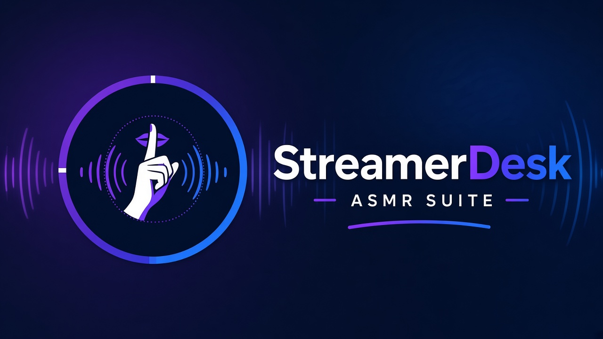

# Streamerdesk ASMR - Espacialidad binaural

**Español** · [English](#english)

Pon tu voz justo detrás de quien te escucha, encima de su cabeza o pegadita a su oído izquierdo… y llévala de un sitio a otro con un deslizamiento suave, sin moverte de tu micro. **Espacialidad binaural** es un filtro de audio gratuito para OBS Studio pensado para ASMR con auriculares, hecho con mucho cariño por [Streamerdesk](https://streamerdesk.com).

Funciona genial con micros USB como Blue Yeti o Rode (aunque sean mono): la salida siempre es estéreo, y puedes ponerlo en cualquier fuente de audio.

### Qué puedes hacer
- **Posiciones rápidas**: oído izquierdo, oído derecho, delante, detrás, encima de la cabeza… o *Personalizada*, con la dirección (0-360°) y la altura (-45° a +90°) exactas.
- **Distancia**: desde pegadita a la oreja, con graves cálidos, hasta el otro lado de la habitación.
- **Deslizamiento suave**: cambia de posición en directo y la voz viaja hasta allí en el tiempo que elijas, por el camino más corto y sin clics.
- **Sonido realista con auriculares**: el pequeño retraso entre oídos, la sombra de la cabeza y los cambios de tono que te dicen si algo está delante, detrás o encima.
- **Presets**: 4 incluidos (*Al oído izquierdo*, *Detrás de ti*, *Encima de la cabeza* y *Frente cercano*) y los tuyos propios, que se guardan solo en tu ordenador.
- **Ayuda en cada control**: pasa el ratón por el iconito (?) y te explica qué hace y para qué sirve en ASMR.

### Instalación (Windows)
1. Cierra OBS Studio.
2. Ejecuta `StreamerdeskASMR-EspacialidadBinaural-1.0.0-windows-setup.exe`. Encuentra OBS solo; si lo tienes en otra carpeta, elígela.
3. Abre OBS, clic derecho en tu micrófono en el Mezclador de audio → **Filtros** → **+** → **Streamerdesk ASMR - Espacialidad binaural**.

**Instalación manual (.zip):** copia las carpetas `obs-plugins` y `data` del zip dentro de tu carpeta de OBS (normalmente `C:\Program Files\obs-studio`).

**Desinstalar:** desde *Configuración → Aplicaciones* de Windows, o borra `obs-plugins\64bit\streamerdesk-asmr-binaural-spatializer.dll` y `data\obs-plugins\streamerdesk-asmr-binaural-spatializer`. Tus presets están en `%APPDATA%\obs-studio\plugin_config\streamerdesk-asmr-binaural-spatializer\presets.json`.

### Primeros pasos
Ponte los auriculares, elige el preset **★ Al oído izquierdo** y después cambia la *Posición rápida* a *Detrás* o *Encima de la cabeza*: oirás cómo tu voz viaja despacito alrededor de la cabeza. Si «detrás» o «encima» no se notan mucho con tus auriculares, sube la **Intensidad de las pistas de dirección**. Cuando te guste, ponle nombre y pulsa **Guardar preset**.

*Un apunte sincero:* cada cabeza y cada oreja son distintas, así que delante/detrás y la altura se notan más en unas personas que en otras. La izquierda/derecha y la distancia funcionan para todo el mundo.

Compatible con OBS Studio 28.0 o posterior en Windows 10/11 de 64 bits. Linux y macOS llegarán más adelante.

Software libre bajo licencia GPL-2.0-or-later. © 2026 Streamerdesk · https://streamerdesk.com

---

# Streamerdesk ASMR - Binaural Spatializer

Put your voice right behind your listener, above their head or close to their left ear… and glide it from one spot to another, without leaving your mic. **Binaural Spatializer** is a free OBS Studio audio filter made for headphone ASMR, crafted with love by [Streamerdesk](https://streamerdesk.com).

It shines on USB mics like the Blue Yeti or Rode (even mono ones): the output is always stereo, and you can use it on any audio source.

### What you can do
- **Quick positions**: left ear, right ear, front, behind, above the head… or *Custom*, with exact direction (0-360°) and height (-45° to +90°).
- **Distance**: from right at the ear, with warm lows, to across the room.
- **Smooth glides**: change position live and your voice travels there in the time you choose, the shortest way and click-free.
- **Realistic in headphones**: the tiny delay between ears, the head's shadow and the tone changes that tell you if something is in front, behind or above.
- **Presets**: 4 built-in (*Al oído izquierdo*, *Detrás de ti*, *Encima de la cabeza* and *Frente cercano*) plus your own, stored only on your computer.
- **Help on every control**: hover the little (?) icon to learn what it does and how it helps your ASMR.

### Install (Windows)
1. Close OBS Studio.
2. Run `StreamerdeskASMR-EspacialidadBinaural-1.0.0-windows-setup.exe`. It finds OBS on its own; pick another folder if yours lives elsewhere.
3. Open OBS, right-click your microphone in the Audio Mixer → **Filters** → **+** → **Streamerdesk ASMR - Binaural Spatializer**.

**Manual install (.zip):** copy the `obs-plugins` and `data` folders from the zip into your OBS folder (usually `C:\Program Files\obs-studio`).

**Uninstall:** from Windows *Settings → Apps*, or delete `obs-plugins\64bit\streamerdesk-asmr-binaural-spatializer.dll` and `data\obs-plugins\streamerdesk-asmr-binaural-spatializer`. Your presets live in `%APPDATA%\obs-studio\plugin_config\streamerdesk-asmr-binaural-spatializer\presets.json`.

### Getting started
Put your headphones on, pick the **★ Al oído izquierdo** preset, then switch *Quick position* to *Behind* or *Above the head*: you'll hear your voice slowly travel around the head. If 'behind' or 'above' feel subtle in your headphones, raise **Direction cue strength**. When you love it, name it and press **Save preset**.

*An honest note:* every head and ear is different, so front/back and height come across more strongly for some people than others. Left/right and distance work for everyone.

Works with OBS Studio 28.0 or newer on 64-bit Windows 10/11. Linux and macOS are coming later.

Free software under GPL-2.0-or-later. © 2026 Streamerdesk · https://streamerdesk.com
